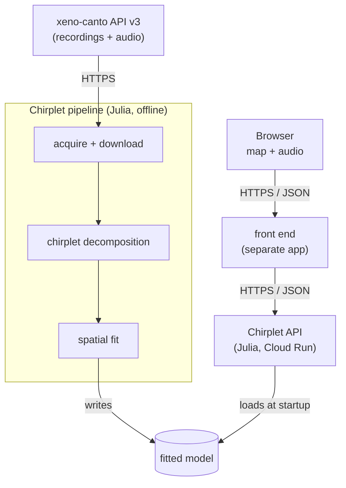
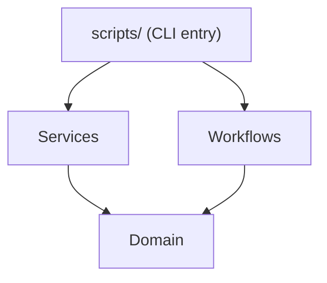
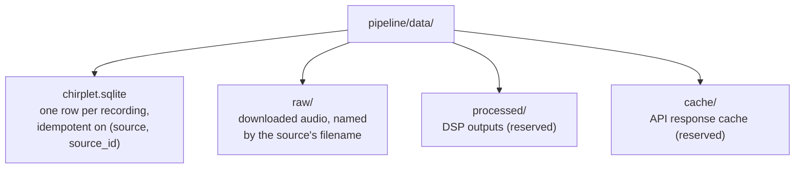

# Chirplet Architecture

Chirplet renders the geographic emergence of White-crowned Sparrow song dialects as a continuous, audible gradient field, served to a separate web front end.
This page describes how the pieces fit together on `main`: what runs where, where data lives, and which dependencies cross which boundaries.

## System Overview



Two artifacts ship from this repo: an offline pipeline that produces a fitted model, and a Cloud Run service that loads the model and answers prediction queries.
Both are Julia.

| Repo | Language | Role |
|---|---|---|
| **chirplet** (this) | Julia | Acquisition, chirplet decomposition, spatial fitting; ships an offline pipeline and a Cloud Run prediction API |
| Front end (separate, host undecided) | Most likely Phoenix LiveView | Web UI; serves the map and audio playback, calls the Chirplet API |
| [**glissando**](https://github.com/real-limoges/glissando) | Rust | GAMLSS library; a sibling project, **not on Chirplet's critical path**, since prediction is server-side in Julia |

Chirplet does not render UI or know about the map.

## The Pipeline (`pipeline/`)

The Julia pipeline is organized as layers with a strict, one-directional dependency graph:



Arrows point from a layer to the layer it depends on.

The point of the layering is to keep the parts that are easy to test (Domain, Workflows) free of IO.
The parts that talk to the outside world (Services) stay isolated behind narrow interfaces.

### Domain: `pipeline/src/domain/`

Pure types and pure functions.
Stdlib only (`Dates`, `UUIDs`).
No SQLite, no HTTP, no JSON.

- **`types.jl`**: sum types (`QualityRating`, `SoundType`, `DataSource`), value types (`GeoCoord`, `Species`), and entities (`RecordingMeta`, `Recording`).
  - `RecordingMeta` carries source-agnostic recording metadata.
    Source-specific fields like xeno-canto URLs live in `Recording.provenance::Dict{String,String}` rather than as typed columns.
  - `QualityRating` is declared best first: `QA = 0` is the *best* rating, and `<` and `sort` follow that declaration order.
    `meets_quality(rating, minimum)` is the predicate for "good enough"; it reads correctly where a raw comparison does not.
  - `parse_soundtype` maps an empty field to `UnknownType`, and checks "dawn" before "song", so "dawn song" is `Dawn`.
- **`filters.jl`**: `RecordingFilter` (an `@kwdef` struct: `min_quality`, `require_coords`, `sound_types`, `country`, `subspecies`, `date_range`) and the pure predicate `matches(filter, meta) :: Bool`.

### Services: `pipeline/src/services/`

Stateful, IO-bound code.
It wraps third-party packages (`SQLite.jl`, `HTTP.jl`, `JSON3.jl`) behind small, named interfaces so workflows can swap them out in tests.

- **`store/`**: SQLite persistence.
  - `schema.jl` defines a single `recordings` table with a `provenance_json TEXT` column (see "Provenance, Not Columns" below).
  - `store.jl` exposes `open_store`, `close_store`, `save_recording`, `count_recordings`, `query_recordings`, `pending_downloads` and `mark_downloaded!`.
  - `query_recordings` accepts a `RecordingFilter` for in-database filtering and returns a `DataFrame`.
  - `pending_downloads` selects rows with `downloaded = 0`, parses each `provenance_json`, and yields `(source, source_id, audio_url, audio_filename)` tuples.
    A row with no `audio_url` is skipped with a warning naming its `source_id`.
  - `mark_downloaded!` sets `audio_path` and `downloaded = 1` once a file lands.
  - `save_recording`'s `ON CONFLICT` clause deliberately does not overwrite `audio_path` or `downloaded`, so a re-acquire never clobbers download progress.
- **`acquisition/`**: the xeno-canto API v3 client.
  - `XenoCantoConfig` holds the base URL, API key and request delay.
  - `RateLimiter` and `throttle!` enforce spacing between requests.
  - `build_query(species, cfg)` produces the v3 tag-based query string: `gen:"Zonotrichia" sp:"leucophrys"`, with ` ssp:"..."` appended only when a subspecies is set.
    Free-text v2-style queries do not work in v3.
  - `fetch_page(cfg, limiter, query, page)` returns `(Vector{Tuple{RecordingMeta,Dict{String,String}}}, total_pages)`: each recording is paired with its provenance dict.
    A parse failure on one recording is logged and skipped, not fatal.
  - `parse_recording(data)` maps one JSON record to `(RecordingMeta, provenance)`.
  - `download_audio_file(url, dest)` GETs to a `.tmp` file and atomically `mv`s it into place, so an interrupted download leaves nothing half-written.

### Workflows: `pipeline/src/workflows/`

Orchestration.
Imports Domain only; **all IO is injected as function arguments**.

There are two:

**Signatures: The Two Workflows**

```julia
acquire_recordings(;
    fetch_page,         # (species, page) -> (Vector{(RecordingMeta, provenance)}, total_pages)
    save_recording,     # (Recording) -> ()
    filter::RecordingFilter,
    species::Species,
    max_pages::Union{Int,Nothing} = nothing,
) -> AcquisitionResult

download_recordings(;
    pending,            # iterable of (source, source_id, audio_url, audio_filename)
    fetch_audio,        # (url, path) -> path
    mark_downloaded,    # (source, source_id, path) -> ()
    dest_path_for,      # (source, source_id, audio_filename) -> String
    throttle = () -> nothing,
) -> DownloadResult
```

`acquire_recordings` walks pages, applies the filter in memory, and writes through the injected sink.
`download_recordings` iterates the pending tuples.
A file already on disk is marked downloaded and counted as skipped, which is what makes the job resumable; anything else is throttled, fetched, and marked.
Per-file errors are counted as `failed` rather than raised, except `InterruptException`, which is re-raised so Ctrl-C still works.

In production the scripts wire these to the xeno-canto client and the SQLite store; in tests they get plain closures, so workflow tests touch no store at all.
The workflows themselves never import either.

### Scripts: `pipeline/scripts/`

The wiring layer.
A script reads TOML, constructs per-service configs, builds closures, and runs a workflow.

There are two entry points, `acquire.jl` and `download.jl`.

`acquire.jl` accepts exactly one flag, `--max-pages <N>` (the smoke-test lever); everything else (paths, species, filter) comes from `config/default.toml`, and the API key from the environment.
After the run it prints a summary: totals, then subspecies counts, quality counts and the lat/lng range over recordings with coordinates, quality C or better, and song.

`download.jl` takes no flags.
It reads `[paths]` and `[api]`, opens the store, and hands `pending_downloads(store)` to `download_recordings` with `download_audio_file` as the fetcher.
It is resumable, so re-running it after an interrupt is safe.

Both guard execution with `if abspath(PROGRAM_FILE) == @__FILE__`, so they can be `include`d in the REPL without auto-running.

### Notebooks: `pipeline/notebooks/`

Outside the layer graph.
Jupyter notebooks (IJulia, run against the pipeline project) hold exploratory work, currently `decomposition_spike.ipynb` for chirplet decomposition.
Nothing here is production code: once a function proves itself it moves into `pipeline/src/` and the notebook imports it instead.
Treat notebook code as disposable and the lifted version as the source of truth.

## Configuration

Configuration is plain TOML loaded with `load_toml(path) -> Dict{String,Any}` (`pipeline/src/config.jl`).
There is no central config struct: `acquire.jl` reads each TOML section and constructs a per-service config (`StoreConfig`, `XenoCantoConfig`) and a `RecordingFilter` directly.
Adding a new workflow means adding a new script that reads the sections it cares about; existing scripts do not need to change.

`pipeline/config/default.toml` ships with defaults targeting White-crowned Sparrow, all subspecies (`target_subspecies = ""`), US only, quality C or better, song only.
The corpus those defaults produced is 350 US recordings with a mixed subspecies breakdown, and no larger corpus is planned.

The xeno-canto API key comes only from the `XENOCANTO_API_KEY` environment variable; the config file has no key slot.
v3 requires a key on every request.

## Data Layout

Everything written by the pipeline lives under `pipeline/data/` (gitignored):



`raw/` holds 350 files, 324 mp3 and 26 wav.
The store's `audio_path` column maps each recording to its file; the name on disk is not load-bearing.
`audio_path` is currently an absolute path on the machine that ran the download.

### Provenance, Not Columns

The `recordings` table stores source-agnostic metadata as typed columns and dumps everything source-specific into a single `provenance_json TEXT` column.
For xeno-canto that is currently `url`, `audio_url`, and `audio_filename`; the license is a typed column.
Adding a second source (Macaulay Library, eBird, a local archive) does not require a migration; it requires populating `Recording.provenance` with whatever keys make sense for that source.

This is also why the schema uses `lng` while the v3 API uses `lon`: the column name is part of the internal contract, and the API field name is mapped at the client boundary.

## DSP, Modeling, and Serving

The DSP layer is **chirplet decomposition**: each recording is decomposed into a bag of chirplet atoms (time × frequency × chirp rate × duration × amplitude).
Atoms are the feature primitive: there is no separate MFCC or mel-spectrogram step and no per-syllable segmentation.
Atoms are chosen because they are low-dimensional, interpretable, and invertible, so a predicted atom set can be resynthesized into audio.

The spatial model fits an atom distribution as a smooth function of (lat, lng).
Boundaries are derived as regions of high gradient magnitude rather than fit directly; the model output is the gradient field itself, not a partition.
The exact parameterization of the atom distribution is still open.

Serving is a Julia HTTP service deployed to Cloud Run.
The fitted model is loaded into the service at startup and answers prediction queries from the front end.
Live re-fitting at request time is not in scope; refits are produced offline by the pipeline and ship by rebuilding the Cloud Run image, since the model is baked into it.
The consumer of the HTTP request and response shape is the front end, so a change to that shape is a change to its contract.

## Testing

`Pkg.test()` runs `pipeline/test/runtests.jl`, the standard Julia test driver.
The Domain and Workflow layers are designed to be tested without IO: workflow tests pass closures for `fetch_page` and `save_recording` rather than touching the network or disk.
The store is tested against a temporary SQLite file.
There are no recorded HTTP fixtures, and the xeno-canto client's network paths are untested.

## CI

`.github/workflows/CI.yml` runs `julia-actions/julia-runtest` against Julia 1.12 on every push to `main` and every PR.
`Manifest.toml` is gitignored, so dependencies are resolved on each run; cache hits depend on `Project.toml` being unchanged.
